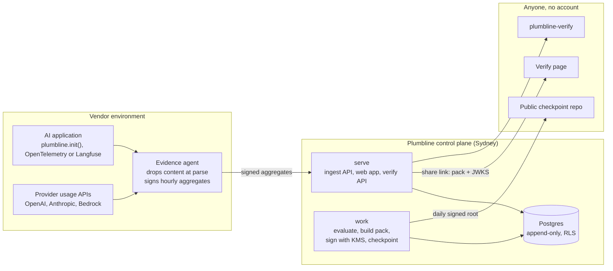

# Plumbline

Plumbline (by Lumetrix) turns an AI product's runtime telemetry into **signed, chained evidence packs** that a bank, insurer or auditor can verify themselves: offline, with no account, and without trusting the vendor or us. Prompts, completions and trace IDs never leave the vendor's environment.

A pack reports ten evidence objectives for one AI system over one period (trace coverage, PII redaction, guardrail coverage, eval freshness and more). Each pack is an in-toto statement in a DSSE envelope, signed with ECDSA P-256 and linked to the previous pack by digest, so an edited pack or a missing month fails verification.

## Status

| Area | State |
| --- | --- |
| Trust core (`internal/jcs`, `dsse`, `merkle`, `pack`) | Built and tested |
| Verifiers: `plumbline-verify` CLI, browser verify page, `concierge/verify.py` | Built; all three agree on every test vector |
| Concierge CLI (`concierge/evidencepack.py`: ingest, evaluate, sign, share) | Built; used to hand-build packs for design partners |
| Evidence agent (`plumbline-agent`: OTLP receiver, Langfuse puller, usage pollers, signed batches, durable queue, `--dry-run`) | Built; waits for the control plane's ingest API |
| Python SDK (`sdk/python`) | Built: helpers and automatic OpenAI, Anthropic and Bedrock instrumentation |
| TypeScript SDK (`sdk/js`) | Built: helpers and automatic OpenAI, Anthropic and Bedrock instrumentation |
| Control plane (`plumbline-server`: migrate, ingest, jobs, evaluator, pack issue and KMS signing, JWKS with rotation, daily checkpoints, share links and verify API, Supabase sign-in, the vendor web app) | Built |
| One-command install, end-to-end CI, Vanta integration, release | In progress (build plan S-5, S-6, Phase 6) (build plan Phases S, 4, 5, 6; D-024, D-025) |

Progress per task: [`docs/progress-tracker.md`](docs/progress-tracker.md). What was built and how it was tested: [`docs/engineering-log.md`](docs/engineering-log.md).

## Quick start

```bash
git clone git@github.com:Lumetrix-Advanced-Technologies/plumbline.git
cd plumbline
make check
```

`make check` runs everything CI runs: gofmt, go vet, staticcheck, govulncheck, the Go tests with `-race`, the cross-implementation vectors (Go, browser verifier under Node, Python) and the concierge tests. It should end with no failures.

Verify the sample packs with the Go verifier:

```bash
go run ./cmd/verify --jwks spec/vectors/test-jwks.json spec/vectors/pass/KST-CTA-0001.dsse.json spec/vectors/pass/KST-CTA-0002.dsse.json spec/vectors/pass/KST-CTA-0003.dsse.json
```

It prints each check and ends with `RESULT: VERIFIED`. Try a tampered pack to see a failure named:

```bash
go run ./cmd/verify --jwks spec/vectors/test-jwks.json spec/vectors/pass/KST-CTA-0002.dsse.json spec/vectors/fail/tampered-payload.dsse.json
```

## Setup

### Requirements

| Tool | Version | Used for |
| --- | --- | --- |
| Go | 1.26 or later (CI uses 1.27) | Everything under `cmd/` and `internal/` |
| Node.js | 22 or later | Tests of the browser verifier (`node --test`, no packages) |
| Python | 3.12 or later, with `cryptography` | Concierge CLI and `verify.py` |
| Docker | any recent | Local Postgres 16 (`make db`) |
| `psql` | 16 | Optional: the SQL tests for row-level security and append-only tables |
| Chrome or Chromium | any recent | Optional: the end-to-end share-link test (skipped when absent) |
| `boto3` | any recent | Optional: signing with AWS KMS from the concierge CLI |

```bash
python3 -m pip install cryptography        # add boto3 for KMS signing
```

Lint tools are run at pinned versions with `go run tool@version`, so nothing needs installing for them (see D-011 in [`docs/decisions.md`](docs/decisions.md)). Keep Go on a patched release: `govulncheck` fails the build on known standard-library vulnerabilities. If your Go install lags behind, `go env -w GOTOOLCHAIN=go1.27.2+auto` makes the `go` command fetch and use that release.

### Local database (for platform work)

```bash
cp .env.example .env.local      # never commit .env.local
make db                         # Postgres 16 in Docker, then migrations
```

The schema is [`migrations/0001_init.sql`](migrations/0001_init.sql): per-tenant row-level security and append-only evidence tables enforced by triggers. The control plane that runs migrations (`cmd/server migrate`) is build task P4-1.

## Using Plumbline

### Verify packs: `plumbline-verify`

```bash
go run ./cmd/verify --jwks <jwks.json | https://issuer/.well-known/jwks.json> [--json] pack1.json [pack2.json ...]
```

- Give packs **oldest first**; each pack after the first is checked against the one before it.
- `--jwks` takes a file or an `https://` URL (plain HTTP is refused).
- `--json` prints one machine-readable report whose per-pack fields match `spec/vectors/manifest.json`.
- Exit code: `0` every pack verified, `1` a pack failed (the output names the failed check), `2` usage or input error.

To build a binary: `go build -ldflags "-X main.version=v0.1.0" -o bin/plumbline-verify ./cmd/verify`.

### Verify packs in a browser: `web/verify/`

The verify page is plain HTML, CSS and JavaScript with no build step. It runs every check in the browser with Web Crypto and shows a pack's contents only when its signature verifies.

```bash
python3 -m http.server 8081 --bind 127.0.0.1
```

Then open <http://127.0.0.1:8081/web/verify/> and choose `spec/vectors/test-jwks.json` as the issuer keys and any files from `spec/vectors/pass/` as packs. Offline mode makes no network requests. A share link (`/verify/?t=<token>`) instead loads the pack from `GET /v1/verify/{token}` and the keys from `/.well-known/jwks.json`. Printing produces a record with the pack ID, full digest and share URL on every page.

The page links `../brand.css`, so a deployment publishes the whole `web/` directory with the page at `/verify/` (D-019).

### Build a pack by hand: the concierge CLI

Until the evidence agent ships, packs for design partners are built with `concierge/evidencepack.py` in four steps. The salt secret for trace commitments comes from `PLUMBLINE_SALT_SECRET` or `--salt-secret-file` (mode 0600), and it never leaves the vendor.

This walkthrough uses the synthetic sample in `concierge/testdata/` and a throwaway key:

```bash
R=$(pwd)                         # run from the root of your checkout
export PLUMBLINE_SALT_SECRET=demo-salt-secret
mkdir -p /tmp/plumbline-demo && cd /tmp/plumbline-demo
openssl ecparam -name prime256v1 -genkey -noout | openssl pkcs8 -topk8 -nocrypt -out key.pem && chmod 600 key.pem
```

1. **Ingest**: exports become hourly aggregates (batch `metrics` shape) and salted Merkle leaves. Content is dropped at parse time; trace IDs leave only as salted leaves. Sources: OTLP JSON or JSONL, Langfuse JSON, JSONL or CSV.

   ```bash
   python3 $R/concierge/evidencepack.py ingest --source otlp --out aggregates.json --leaves leaves.txt $R/concierge/testdata/otlp-sample.jsonl
   ```

2. **Evaluate**: aggregates plus provider usage and the registers become the ten objectives.

   ```bash
   D=$R/concierge/testdata/demo
   python3 $R/concierge/evidencepack.py evaluate --system $D/system.json --aggregates aggregates.json --usage $D/usage.csv --changes $D/changes.csv --out evaluation.json
   ```

   It prints each objective. The sample deliberately contains message content, unguarded calls and unacknowledged anomalies, so it ends 4 pass, 1 attention, 5 fail.

3. **Sign**: build the predicate, check it against `spec/pack.schema.json`, sign, and verify the signature before writing. `--prev` chains the next pack; `--kms-key-id <arn>` signs with AWS KMS instead of a local key.

   ```bash
   python3 $R/concierge/evidencepack.py sign --evaluation evaluation.json --leaves leaves.txt --pack-id DEMO-0001 --kid demo-key --key key.pem --jwks-out jwks.json --sample-notice "SAMPLE. Synthetic data." --out DEMO-0001.dsse.json
   python3 $R/concierge/evidencepack.py sign --evaluation evaluation.json --leaves leaves.txt --pack-id DEMO-0002 --prev DEMO-0001.dsse.json --kid demo-key --key key.pem --out DEMO-0002.dsse.json
   (cd $R && go run ./cmd/verify --jwks /tmp/plumbline-demo/jwks.json /tmp/plumbline-demo/DEMO-0001.dsse.json /tmp/plumbline-demo/DEMO-0002.dsse.json)
   ```

   `--disclose <trace id>` reveals one trace with its Merkle proof.

4. **Share**: publish a verified pack behind an unguessable link on a static site in the same shape as the future API.

   ```bash
   python3 $R/concierge/evidencepack.py share --pack DEMO-0002.dsse.json --prev DEMO-0001.dsse.json --jwks jwks.json --site-dir site --base-url http://127.0.0.1:8090 --verifier "Example Bank"
   python3 -m http.server 8090 --bind 127.0.0.1 --directory site
   ```

   Open the printed link: the page shows "Verified, unaltered since signing". The link is printed once; `share-log.csv` (beside the site, never inside it) keeps only the token's SHA-256. `evidencepack.py unshare --site-dir site --token-sha256 <hash>` revokes it.

Input formats, attribute names and evaluation rules are described in [`concierge/README.md`](concierge/README.md) and decisions D-020 to D-023.

## Architecture



One Go module builds three binaries: `cmd/agent` (evidence agent), `cmd/server` (`serve`, `work`, `migrate`) and `cmd/verify`. The SDKs in `sdk/` send spans to the agent. The control plane is planned; the formats, verifiers, agent and concierge pipeline it relies on exist today.

### Formats

The normative description is [`docs/architecture.md`](docs/architecture.md) §2. In short:

| Layer | Rule |
| --- | --- |
| Canonical JSON | RFC 8785 (JCS). Keys sorted by UTF-16 code units, ECMAScript number form. The payload must be exactly JCS(statement). |
| Statement | in-toto Statement v1; subject digest = SHA-256 of JCS(predicate); predicate schema `assurance-pack/v0.1` ([`spec/pack.schema.json`](spec/pack.schema.json)) |
| Envelope | DSSE; the signature covers the PAE `DSSEv1 <len> <type> <len> <body>` |
| Signature | ECDSA P-256 / SHA-256, ASN.1 DER. KMS signs the 32-byte digest of the PAE (`MessageType=DIGEST`). Agent batches use Ed25519. |
| Chain | pack digest = `sha256:` + SHA-256(payload); each pack's `prev_pack_digest` names the previous pack |
| Commitment | leaf = `sha256(0x00 ‖ salt16 ‖ trace_id)`, salt = HMAC-SHA256(secret, trace_id)[:16]; node = `sha256(0x01 ‖ left ‖ right)`; odd node carried up |

### The verifiers must agree

`spec/vectors/` is the contract. `manifest.json` lists 8 cases (three chained passing packs and five single failures) with the exact result every verifier must return. `extra-manifest.json` adds 14 cases, including packs every verifier must refuse. The Go tests and `web/verify/verify.test.js` both run them, and `make vectors` runs them with the reference test and `verify.py`. Vectors are never edited to make a test pass; new ones are added.

### Repository layout

| Path | What |
| --- | --- |
| `cmd/verify/` | `plumbline-verify` CLI |
| `cmd/agent/` | `plumbline-agent`: enrol, run, `--dry-run`, `--replay` |
| `cmd/server/` | `plumbline-server`: `serve`, `work`, `migrate`, `keys` |
| `internal/store`, `server`, `jobs`, `evaluate`, `issue`, `kmssign`, `keys`, `checkpoint`, `dailycheckpoint`, `share`, `auth`, `webapp` | The control plane |
| `web/app/` | The vendor web app's templates and stylesheet |
| `internal/agent/`, `otlp/`, `langfuse/`, `usage/`, `aggregate/`, `commitment/`, `enrol/`, `batchsign/`, `queue/` | The agent's pipeline |
| `sdk/python/` | Python SDK (`plumbline.init()`), standard library only |
| `sdk/js/` | Node.js/TypeScript SDK (`@plumbline/sdk`), no dependencies |
| `sdk/testdata/` | The shared SDK scenario every SDK and the agent must agree on |
| `internal/jcs/` | RFC 8785 serializer and strict parser |
| `internal/dsse/` | DSSE envelopes, PAE, P-256 and Ed25519 signers, verification |
| `internal/merkle/` | Salted trace commitment, proofs |
| `internal/pack/` | Pack types, digest, chain, full verification, JWKS |
| `internal/spec/` | Cross-checks of the spec files |
| `web/verify/` | Static verify page (`verify.js` is the browser verifier) |
| `web/brand.css` | Plumbline brand tokens, light and dark |
| `spec/` | Schemas, the ten objectives, framework references, OTel name map, test vectors |
| `migrations/` | Numbered SQL migrations and their tests |
| `concierge/` | Python concierge CLI and `verify.py` (frozen after Milestone 1) |
| `reference/` | The original sample verify page and the reference verifier test |
| `docs/` | Overview, architecture, build plan, standards, decisions, engineering log, progress tracker |

## Contributing

Read [`CLAUDE.md`](CLAUDE.md) first. It lists the rules no change may break:

- **No content leaves the customer.**
- **The verifiers must agree.**
- **Standard library first.** Only the listed Go modules are allowed, with no npm packages and no build step.
- **Evidence is append-only.**
- **Migrations are immutable.**
- **Framework references are IDs and our own short titles only.**
- **No secrets or tokens in logs.**
- **Phases 3–6 wait for the Milestone 1 gate.**

The workflow, one task per pull request:

1. Pick the next task in [`docs/progress-tracker.md`](docs/progress-tracker.md) and read it in [`docs/build-plan.md`](docs/build-plan.md).
2. Branch (`p1-2-dsse`, `c-3-concierge-sign`) and write the acceptance tests first.
3. Run `make check` until it is green.
4. Update the tracker and the engineering log, and add a decision record for any design choice.
5. Open a pull request listing the acceptance tests and how they were run; the other founder reviews it.

Code style and the dependency allowlist are in [`docs/code-standards.md`](docs/code-standards.md); notes on every external API are in [`docs/library-docs.md`](docs/library-docs.md).

## Documents

| Document | Contents |
| --- | --- |
| [`docs/project-overview.md`](docs/project-overview.md) | Product, users, scope, non-goals, milestones, glossary |
| [`docs/architecture.md`](docs/architecture.md) | Components and normative formats |
| [`docs/build-plan.md`](docs/build-plan.md) | Tasks P0–P6 and C-1–C-4 with acceptance tests |
| [`docs/decisions.md`](docs/decisions.md) | Decision log, D-001 onwards |
| [`docs/engineering-log.md`](docs/engineering-log.md) | What each task built, problems met, how it was verified |
| [`docs/progress-tracker.md`](docs/progress-tracker.md) | Task status and milestone gates |
